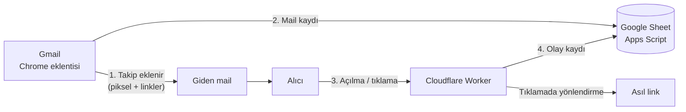

# FiS Mail Takip

Gmail'den gönderdiğin maillerin **açılıp açılmadığını** ve **linklerine tıklanıp tıklanmadığını** kendi Google Sheet'inde takip etmeni sağlayan, açık kaynaklı ve ücretsiz bir sistem.

Mailtrack ya da HubSpot gibi hazır servislerin yaptığı işi yapar, ama veriler **senin** hesaplarında kalır: Google Sheet'in, Cloudflare Worker'ın ve Chrome'un. Arada üçüncü bir şirket yoktur.

> **Durum:** Beta. Gmail'in arayüzü zaman zaman değiştiği için Chrome eklentisinin güncellenmesi gerekebilir.

---

## Neler yapabilir?

- **Açılma takibi:** Her maile görünmez, 1x1 piksellik bir resim eklenir. Alıcı maili açtığında resim yüklenir ve açılma kaydedilir.
- **Tıklama takibi:** Maildeki linkler, **Gmail imzandaki linkler dahil**, o maile özel takip linklerine çevrilir. Böylece kimin hangi linke tıkladığı görünür.
- **Otomatik çalışma:** Chrome eklentisi, Gmail'de yazdığın her maile takibi kendisi ekler. Butona basman gerekmez.
- **Kendi açmaların sayılmaz:** Yazarken, taslağı önizlerken ya da gönderilmiş maili tekrar açarken oluşan kayıtlar ayıklanır.
- **Gürültü ayıklama:** Apple Mail'in gizlilik korumasından ve kurumsal güvenlik tarayıcılarından gelen sahte açılmalar "şüpheli" olarak ayrı tutulur.
- **Toplu gönderim:** Sheet'teki **Kuyruk** sekmesinden kişiselleştirilmiş (`{{Ad}}`) mailleri taslak olarak oluşturabilir ya da doğrudan gönderebilirsin.

## Nasıl çalışır?

1. **Chrome eklentisi** mail yazılırken maile piksel ekler, linkleri takip linkine çevirir ve maili Sheet'e "gönderilmedi" olarak kaydeder.
2. Alıcı maili açınca piksel **Cloudflare Worker**'dan yüklenir. Linke tıklarsa Worker tıklamayı kaydedip kişiyi asıl adrese yönlendirir.
3. Worker olayı **Apps Script web uygulamasına** iletir. Apps Script maili Gönderilmiş klasöründe takip kimliğinden bulur, "gönderildi" olarak işaretler ve olayı Sheet'e yazar.

## Bileşenler

| Klasör | Ne işe yarar | Nerede çalışır |
|---|---|---|
| [`worker/`](worker/) | Pikseli sunar, tıklamaları yönlendirir, olayları Sheet'e iletir | Cloudflare Workers (ücretsiz plan yeterli) |
| [`apps-script/sheet/`](apps-script/sheet/) | Olayları kaydeder, gönderimi doğrular, sahte açılmaları ayıklar, Kuyruk menüsü | Google Sheet'e bağlı Apps Script |
| [`chrome-eklentisi/`](chrome-eklentisi/) | Gmail'de her maile otomatik takip ekler | Chrome (Manifest V3) |
| [`apps-script/gmail-eklentisi/`](apps-script/gmail-eklentisi/) | *İsteğe bağlı.* Gmail'de "Takip ekle" butonu; telefondan veya başka bilgisayardan gönderirken | Google Workspace Gmail eklentisi |

## Sheet'te ne görürsün?

**Gönderimler** sekmesinde her mail tek satırdır:

| Takip ID | E-posta | Konu | Yöntem | Gönderim | İlk açılma | Açılma | Şüpheli açılma | Tıklama |
|---|---|---|---|---|---|---|---|---|
| `9f3a…` | ayse@ornek.com | Teklif | Chrome — gönderildi | 15.10 10:42 | 15.10 11:05 | 2 | 1 | 1 |

**Olaylar** sekmesinde her açılma ve tıklama ayrı bir satırdır. Bu satırlarda zaman, alıcı, konu, tıklanan link, değerlendirme (Gmail, Yandex Mail, Apple Gizlilik Koruması…), ülke ve ağ bilgisi yer alır.

## Kurulum

Adım adım anlatım için **[docs/KURULUM.md](docs/KURULUM.md)** dosyasına bak. Kurulum yaklaşık 20 dakika sürer:

1. Google Sheet oluştur ve Apps Script kodunu ekle.
2. Apps Script'i web uygulaması olarak yayınla.
3. Cloudflare Worker'ı kur ve gizli anahtarı ekle.
4. Chrome eklentisini yükle ve ayarlarını doldur.
5. *(İsteğe bağlı)* Gmail eklentisini kur.

## Bilinen sınırlar

- **Açılma takibi kesin değildir.** Apple Mail resimleri önceden indirir. Kurumsal Outlook resimleri engelleyebilir. Gmail resmi önbelleğe aldığı için aynı kişinin tekrar açışları her zaman görünmez. Tıklama takibi çok daha güvenilirdir.
- **Chrome eklentisi yalnızca kurulu olduğu Chrome'da çalışır.** Telefondan gönderilen mailler için Gmail eklentisini kullan.
- **E-posta adresi linkleri (`mailto:`)** takip edilemez.
- **Gmail'in arayüzü değişirse** eklentinin güncellenmesi gerekebilir.
- **Kendi alan adını kullanmak önerilir.** `workers.dev` adresli linkler bazı spam filtrelerine takılabilir. Worker'a `t.alanadin.com` gibi bir alt alan adı bağlayabilirsin. Bu durumda Chrome eklentisinin `manifest.json` dosyasındaki `host_permissions` listesine bu adresi de eklemen gerekir.

## Gizlilik ve yasal sorumluluk

E-posta açılma ve tıklama takibi kişisel veri işlemesidir. Bu aracı kullanan kişi, alıcılarına karşı **KVKK** (Türkiye), **GDPR** (AB) ve yürürlükteki diğer mevzuattan **kendisi sorumludur**.

- Gönderdiğin maillerde veya gizlilik politikanda, açılma ve tıklama ölçümü yaptığını belirt.
- Topladığın veriyi yalnızca iletişim amacıyla kullan ve gereğinden uzun saklama.
- Worker; IP adresi kaydetmez. Ülke, ağ (ASN) ve tarayıcı bilgisini kaydeder.

Bu yazılım "olduğu gibi" sunulur; ayrıntılar için [LICENSE](LICENSE) dosyasına bak.

## Güvenlik

- **Gizli anahtar (SECRET)** üç yerde bulunur: Apps Script'in Script Properties alanında, Cloudflare'in Secret değişkeninde ve Chrome eklentisinin tarayıcı deposunda. Repoya hiçbir zaman eklenmez.
- **Takip linkleri HMAC ile imzalanır.** Bu yüzden Worker, başkalarının kullanabileceği açık bir yönlendirme servisine dönüşmez.
- **Apps Script web uygulaması**, doğru SECRET'ı göndermeyen istekleri reddeder.

Bir güvenlik açığı bulursan lütfen herkese açık bir issue açmak yerine depo sahibiyle doğrudan iletişime geç.

## Lisans

[MIT](LICENSE) © Berkay Çınar — Fener Interactive Studio
